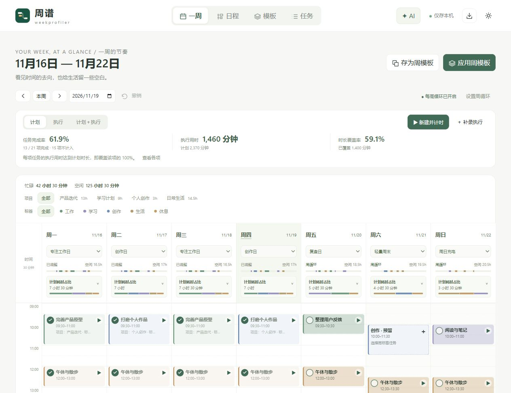
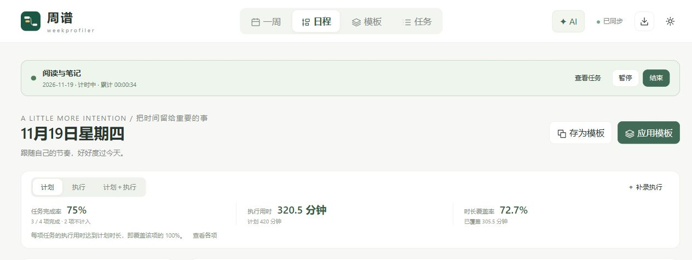
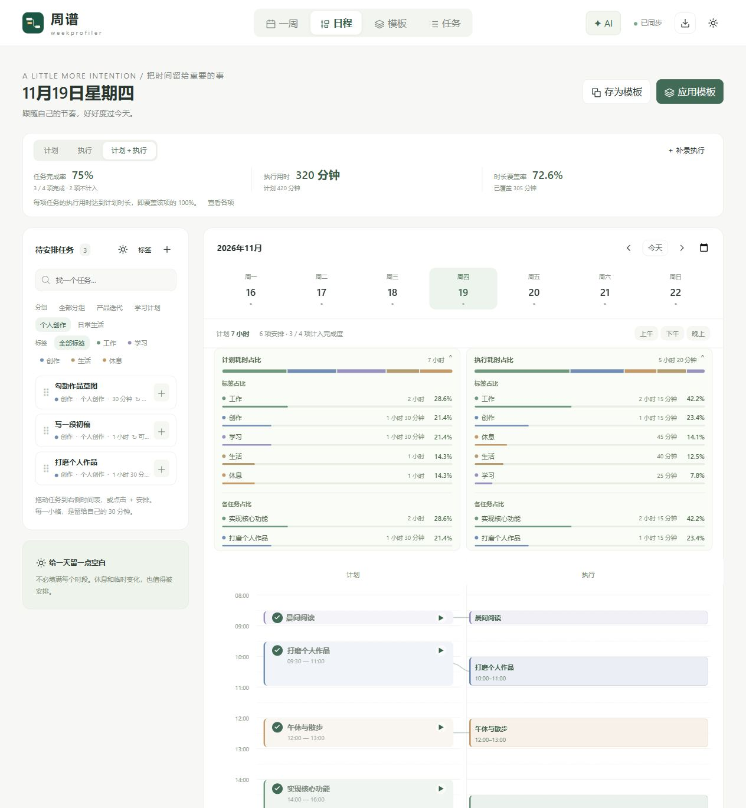
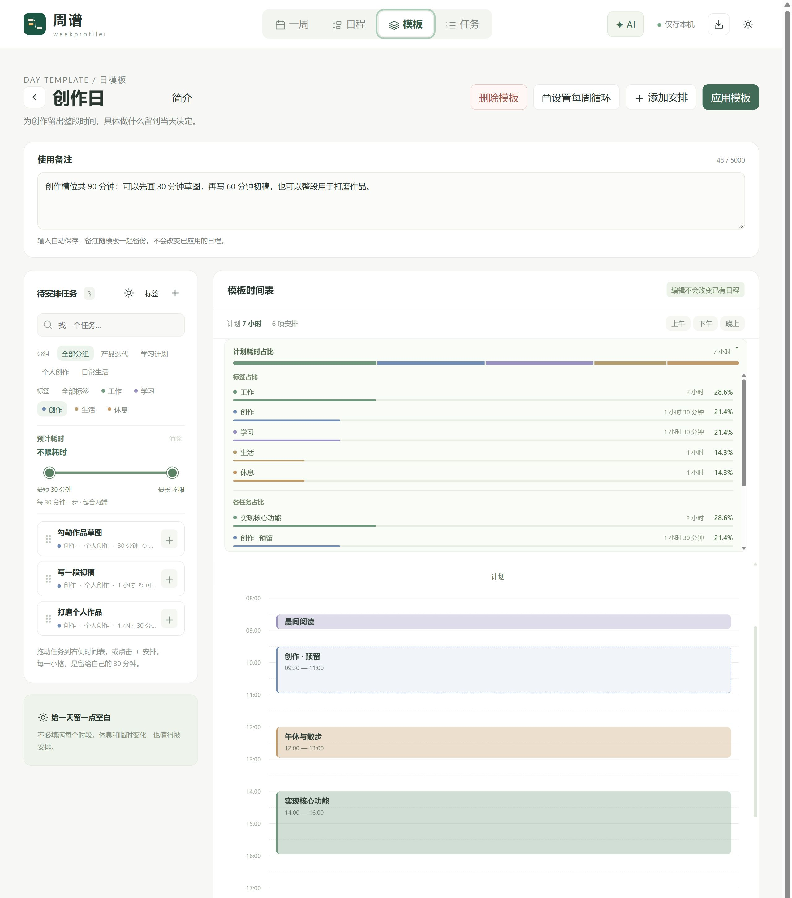
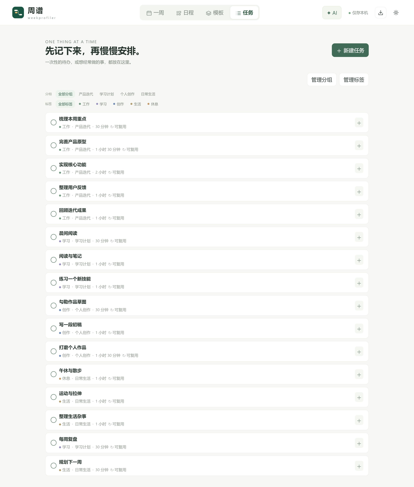
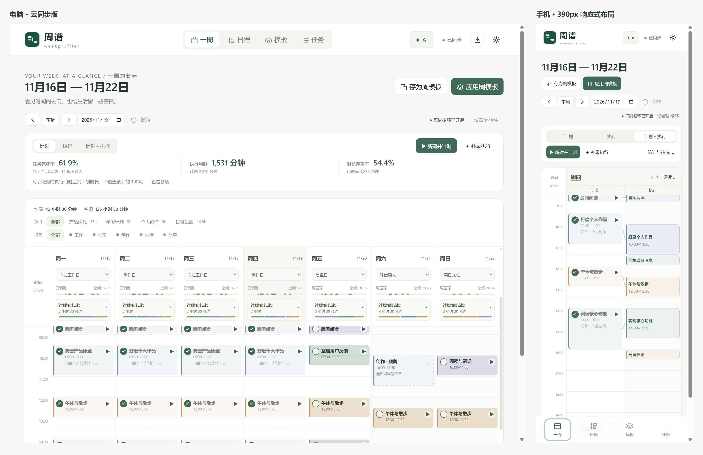
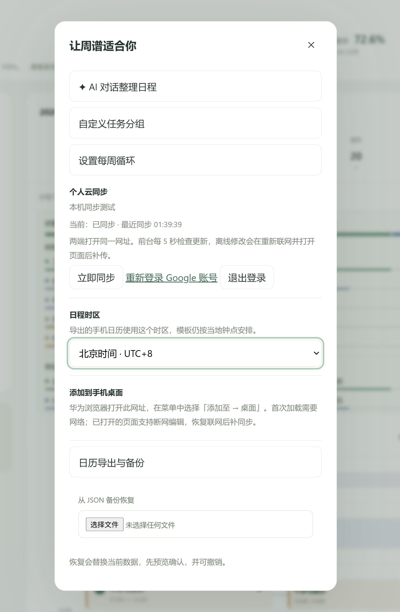

<p align="center">
  
</p>

<h1 align="center">周谱 · weekprofiler</h1>

<p align="center"><strong>开发说明：本项目基本完全由 AI 开发。</strong></p>

<p align="center"><strong>给一周定节奏，让计划与真实投入一起可见。</strong></p>
<p align="center">周循环 · 日 / 周模板 · 任务计时 · 耗时占比 · 免费自托管同步</p>
<p align="center">
  <a href="#start">快速开始</a> ·
  <a href="#features">功能一览</a> ·
  <a href="docs/cloudflare-setup.md">部署自己的云端</a> ·
  <a href="#ai">AI（测试性）</a> ·
  <a href="LICENSE">MIT</a>
</p>

[](docs/images/local-week.jpg)

*点击图片可查看高清原图。*

周谱是一款围绕**每周循环**设计的个人时间管理工具。先整理任务，再给一周定一个可复用的大纲；到了当天，从计划开始计时，记录真实投入，再用计划与执行对照调整下一周。

可以离线打开独立 HTML，也可以用自己的 Cloudflare 免费账号部署同步版，在电脑和手机上接着安排。

> 截图均来自实际运行的周谱，使用专门创建的**虚构演示周表**。云同步截图来自独立的本机同步测试环境，运行仓库中的真实同步接口；不包含个人日程，也不代表线上登录或手机真机验证。详见[截图与演示数据说明](docs/screenshots.md)。

<a id="features"></a>

## 一套从计划到复盘的工作流

| 你想做的事 | 周谱提供的功能 |
| --- | --- |
| 给每周建立稳定节奏 | 七天时间轴、跨天拖动、周模板、每 7 天重复的周循环 |
| 看见计划与实际的差距 | 从计划开始计时、临时任务计时、暂停 / 继续、执行补录、日 / 周对照 |
| 了解时间花在哪里 | 标签占比、各任务占比、执行总时长、任务完成率、时长覆盖率 |
| 复用大纲，同时保留弹性 | 日模板、周模板、模板备注、按标签预留时段、当天再选择具体任务 |
| 先整理任务，再排时间 | 独立的项目分组与标签、任务池筛选、拖入日程、按预计耗时挑选任务 |
| 在不同设备继续安排 | 免费额度内零服务费的自托管同步、离线副本、联网补同步、JSON 备份 |

### 1. 用周视图，安排可以循环的一周

把工作、学习、创作和休息放在同一张时间表里。每天可以选择不同日模板，也可以直接编辑、移动或调整一个时间块。

- **周模板保存节奏**：例如周一、周三深度工作，周二、周四创作，周五复盘，周末恢复。
- **周循环减少重复安排**：启用后每 7 天重复，可设置起止日期。
- **临时变化留在当天**：调整某天形成独立例外，也可以恢复周循环。
- **日视图处理细节**：在一天与一周之间切换，按项目或标签聚焦。

一天从 **04:00 到次日 04:00**，凌晨的活动可以自然接在前一晚后面。

### 2. 从计划开始计时，看见真实投入

点击计划任务上的 `▶`，就能开始一条关联该计划的执行记录。临时出现的工作也可以直接「新建并计时」，之后与其他记录一起回看。

[](docs/images/cloud-timer.jpg)

支持暂停、继续、结束、补录和修正。暂停间隔不累计，同一任务的多段执行会汇总；刷新或重新打开同一入口后仍可恢复计时状态。结束计时后，可以另行标记任务完成。

**日视图和周视图都有「计划」「执行」「计划＋执行」**。左右时间轴和关联连线帮助你看清：哪些事推迟了、哪些投入超出预期、哪些还没开始。

[](docs/images/cloud-day-compare.jpg)

**时间分配与计划 loss**

- **耗时占比**分为标签占比与各任务占比，分别回答“哪类事情占得最多”和“具体哪项任务花了多久”。空白时间不计入占比。
- **任务完成率**按勾选完成的任务数计算，分组和标签可以设置是否参与。
- **时长覆盖率**衡量实际投入覆盖了多少具体计划。每项任务最多覆盖自己的计划时长，多花在一项任务上的时间不会抵消另一项的缺口。

可以用“未覆盖比例”理解计划与实际的 **loss**：

```text
已覆盖时长 = Σ min(每项计划时长, 该项实际累计时长)
时长覆盖率 = 已覆盖时长 / 总计划时长
未覆盖比例（loss）= 1 − 时长覆盖率
```

例如两项任务各计划 60 分钟，实际分别投入 90 和 30 分钟：覆盖率是 **75%**，未覆盖比例是 **25%**。当前界面显示“时长覆盖率”；这里的 loss 是它的补数，用于理解投入差距。尚未选定具体任务的标签槽位不参与覆盖率，修改计划后统计会按当前计划重算。

这项指标衡量时间投入的覆盖情况，具体产出仍可结合任务完成状态和复盘判断。没有具体计划时，覆盖率显示为 `—`。

### 3. 日模板 + 周模板：先留时间，再决定做什么

“工作日”“创作日”“轻量周末”可以分别保存成日模板，再组合成不同的周模板。模板也能保存备注，记录使用方式和复盘心得。

[](docs/images/local-template-slots.jpg)

在模板中选择 **「添加安排 → 按标签预留」**，就能先留一段“学习”或“创作”时间。应用到具体日期后，再填入该标签下的任务：

1. 模板先预留 90 分钟「创作」。
2. 当天选择 30 分钟的「勾勒作品草图」。
3. 剩下 60 分钟继续保留，可以安排「写一段初稿」。

这次选择只影响当天，模板中的大纲仍可复用。挑选任务时，可以同时按分组、标签、名称和预计耗时筛选。

### 4. 任务池：先理清要做的事，再放进时间表

**项目分组**表示“这件事属于哪个项目”，**标签**表示“这是一类什么活动”。两者独立组合，时间块按标签着色。

[](docs/images/local-task-pool.jpg)

例如“产品迭代”项目中，可以同时有工作、学习和创作任务。先把任务收进任务池，再按当前目标筛选、拖入日程。标签支持常用配色和自定义颜色，日程、模板与执行时间线保持一致。

### 5. 免费自托管的端云同步，随时接着安排

用 **Cloudflare Workers Free + D1 + 免费 `workers.dev` 地址**部署自己的实例，Google 登录负责验证身份。电脑和手机打开同一网址、使用允许的邮箱登录，就能共享任务、模板、日程、完成状态、执行记录和计时状态。

[](docs/images/cloud-layouts.jpg)

*左侧为 1280 CSS 像素宽的桌面布局，右侧为 390 CSS 像素宽的手机布局；两者由浏览器加载同一独立同步测试实例，手机侧为浏览器模拟。*

[](docs/images/cloud-sync.jpg)

- **数据放在自己的账号里**：每套部署服务于一个人，其他使用者可以部署各自的实例。
- **先保存本机，再同步**：首次联网登录并缓存成功后，可以离线编辑，重新联网后补同步。
- **跨端接续计时**：同步版同时只接受一个计时器，操作会检查版本，避免重复累计。
- **冲突保留处理入口**：不同字段的修改可合并，同一内容冲突时保留本机草稿并提示核对。
- **数据可以带走**：完整 JSON 备份用于迁移与恢复，ICS 导出用于手动导入日历。

**免费额度内，同步服务费为 0 元，无需购买服务器或域名。** Workers Free 与 D1 都有用量限制，保持免费套餐时超额会受到服务限制；周谱不会自动开通付费套餐。额度以 [Workers 官方限制](https://developers.cloudflare.com/workers/platform/limits/)和 [D1 官方价格说明](https://developers.cloudflare.com/d1/platform/pricing/)为准。

手机关闭页面后不保证后台联网，重新打开时补同步。独立 HTML 与本机排程服务各自在浏览器中保存数据；要跨设备同步，请使用自行部署的同步版。

**[按步骤部署自己的云同步 →](docs/cloudflare-setup.md)**

<a id="start"></a>

## 快速开始

### 本机离线使用

下载或克隆仓库，安装 **Node.js 24 或更新版本**，在项目目录执行：

```sh
node portable.mjs
```

双击生成的 **`weekprofiler-preview.html`** 即可开始。生成后的文件内含完整界面，可以离线打开，也可以单独复制到另一台电脑。日程保存在当前浏览器中。

第一次使用，可以把内置的「创作日」应用到今天，点开「创作」预留时段选择任务，再点 `▶` 开始计时。也可以先从「任务」整理自己的清单，再创建适合自己的模板。

<details>
<summary>想体验截图中的虚构周表？</summary>

下载[基础演示周表](docs/demo-week.json)，或体验[首图中的计划与执行示例](docs/demo-week-lived-in.json)。后者加入错峰、分段和临时任务的执行记录，也用于桌面与手机布局对比图。

在新的、独立的周谱入口中，通过「设置 → 从 JSON 备份恢复」导入。演示日期为 **2026-11-16 至 2026-11-22**；导入后用日期选择器跳到该周。基础备份包含 16 个任务、5 个日模板、2 个周模板及虚构执行记录。

**恢复备份会替换目标入口的当前数据**，体验前请先导出已有内容，或使用没有个人日程的新浏览器配置。

</details>

### 手机与电脑同步

按[个人云同步部署指南](docs/cloudflare-setup.md)创建自己的实例。两端打开同一网址并登录；手机可通过浏览器的“添加到主屏幕”保存入口。

| 使用方式 | 数据保存位置 |
| --- | --- |
| 独立 HTML / 本机排程服务 | 当前浏览器的本地存储 |
| 自托管同步版 | 自己的 Cloudflare D1；浏览器保存离线副本和待同步修改 |
| JSON 完整备份 | 自己选择的下载位置，可迁移任务、模板、日程及执行记录 |

不同浏览器、文件路径、网址或端口不保证共用本机数据。升级、迁移或清理浏览器数据前，请先导出 JSON 备份。ICS 是日历快照，之后修改周谱不会自动更新已导入的日历。

<a id="ai"></a>

## AI 排程 · 测试性功能

**AI 目前是可选的测试性功能，仍在验证与改进中。** 核心的任务管理、模板、排程、计时和同步均可独立使用。

本机 AI 通过同一台电脑上的官方 Codex CLI 工作。安装 CLI 后通过 `codex login` 使用 ChatGPT 账号登录，再运行：

```sh
node portable.mjs
node local-ai-server.mjs
```

打开终端显示的本机网址，默认是 `http://127.0.0.1:5173`，进入「AI」。可以尝试：“把学习任务安排在下午，每天最多两小时，晚上留出休息时间。”

生成草案时，选定范围的任务、安排和本次对话会交给 Codex 处理。你可以继续调整草案，**确认应用后**才写入日程，并支持撤销。

AI 依赖本机服务、Codex 登录和账号可用额度，效果与可用性可能变化；手机与云同步版无法独立调用电脑上的 CLI。AI 使用条件与免费云同步方案分开。

## 开发与贡献

源码使用 JavaScript ES 模块。本地构建和测试只需要 Node.js；部署 Cloudflare 时再安装锁文件指定的 Wrangler。

```sh
node --test "tests/*.test.mjs"
node portable.mjs
node build.mjs
```

修改界面后，重新生成独立 HTML 并刷新即可预览。验证同步时，先构建，再执行：

```sh
node cloud-preview.mjs
```

访问 `http://127.0.0.1:5190` 与 `http://localhost:5190`，可以在一台电脑上验证两个独立浏览器来源共享同一测试数据库的行为。该服务只监听本机，使用模拟身份和 `.sites-runtime/` 中的测试数据库。

| 位置 | 内容 |
| --- | --- |
| `web/` | 日 / 周时间线、模板、任务池、统计、离线缓存与同步客户端 |
| `lib/` | 排程模型、旧备份迁移、计时统计、计划关联与同步逻辑 |
| `worker/`、`drizzle/` | 服务端接口、身份验证、D1 数据库迁移 |
| `tests/` | 模型、界面行为、备份兼容与同步回归测试 |

欢迎通过 Issue 分享使用场景与建议。报告问题时，请提供使用方式、浏览器、复现步骤和预期结果；示例任务可使用虚构数据。提交改动时，请说明对旧备份和已有计划的影响，并为数据或同步行为补充相应回归测试。

周谱由项目发起人设计，OpenAI Codex 作为 AI 编程助手参与开发。[项目贡献者](CONTRIBUTORS.md) · [MIT 许可证](LICENSE)
